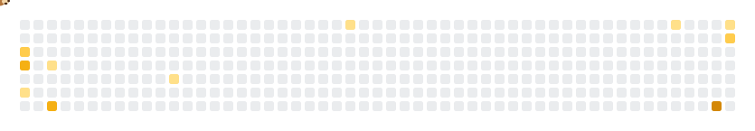

  

  

### 🧀 About me

- 🐭 Small, fast and hard to catch (especially by bugs)
<!-- PROJECT:START -->
- 🔭 Currently working on: **[fancy_secret_santa](https://github.com/aalexeee22/fancy_secret_santa)**
<!-- PROJECT:END -->

  

### 🛠️ Tech I use

  
   
  
  
  

### 📊 Stats

  
  

  

### 🧀 My contributions (nibbled)

  

  

